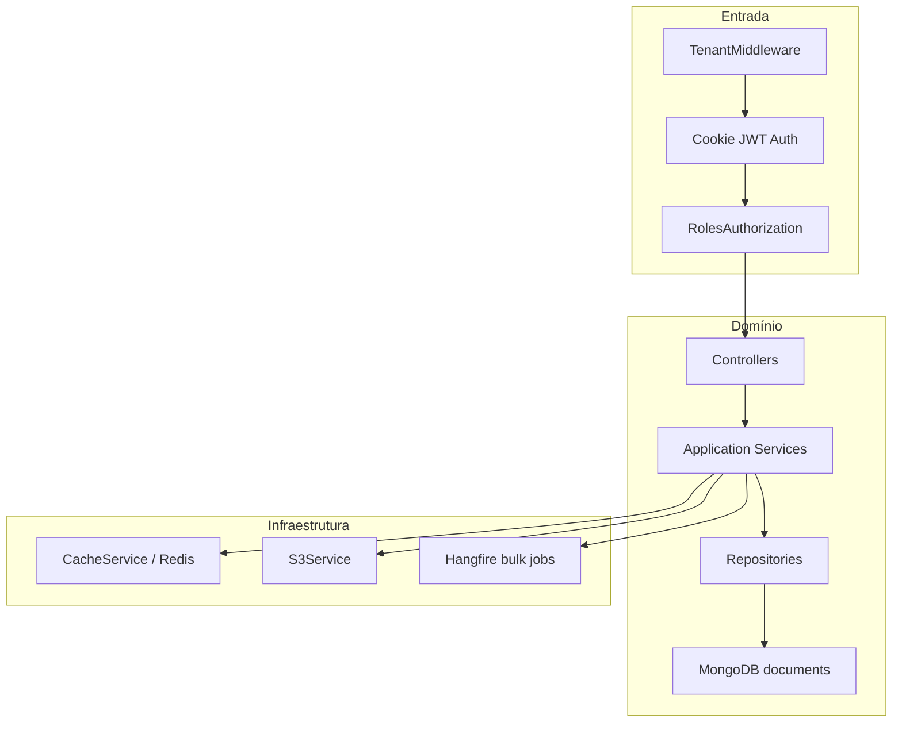

# Arquitetura — Organograma API

Visão técnica da API ASP.NET Core 10 multi-tenant: camadas, módulos, isolamento e Hangfire.

## Visão geral



Pipeline HTTP:

1. **TenantMiddleware** resolve `tenantId` (JWT → `X-Tenant-Slug` → subdomínio)
2. **JWT cookie** + atributos de roles autenticam e autorizam
3. **Controller** recebe entrada (JSON / multipart)
4. **Service** aplica regras de negócio
5. **Repository** acessa MongoDB escopado por tenant
6. Side effects: cache Redis, S3, Hangfire

Erros de domínio usam `AppException` + filtro global `{ error, code, message }`.

## Layout

```
src/
  Organograma.Api/             # Program.cs, Controllers, Middleware, Filters
  Organograma.Application/     # Services, branding, options
  Organograma.Domain/          # Entities, Roles, TenantHelpers
  Organograma.Infrastructure/  # Mongo, Redis, S3, Hangfire, repos
```

## Módulos

| Área | Prefixos |
|------|----------|
| Auth | `/api/usuarios`, `/api/usuarios/manage` |
| Tenants | `/api/tenants` |
| Funcionários | `/api/funcionarios` |
| Setores | `/api/setores` |
| Referências | `/api/referencias` |
| Cargos | `/api/cargos-comissionados` |
| Search | `/api/search` |
| Dashboard | `/api/dashboard` |
| Audit | `/api/audit` |
| Health | `/`, `/health`, `/metrics` |

## Filas (Hangfire)

Jobs bulk (threshold 200):

| Job | Uso |
|-----|-----|
| `delete-users` | Exclusão em massa |
| `export-csv` | Exportação CSV |

Status: `GET /api/funcionarios/jobs/:jobId`.

## Multi-tenant

Modelo: MongoDB compartilhado + campo `tenantId`.

| Camada | Isolamento |
|--------|------------|
| MongoDB | Filtros `tenantFilter` nos repositórios |
| Redis | Prefixo `tenant:{id}:…` + version bump |
| S3 | Prefixo `uploads/{tenantId}/…` |

## Relacionado

- [API.md](API.md) — rotas
- [README.md](../README.md) — visão geral
